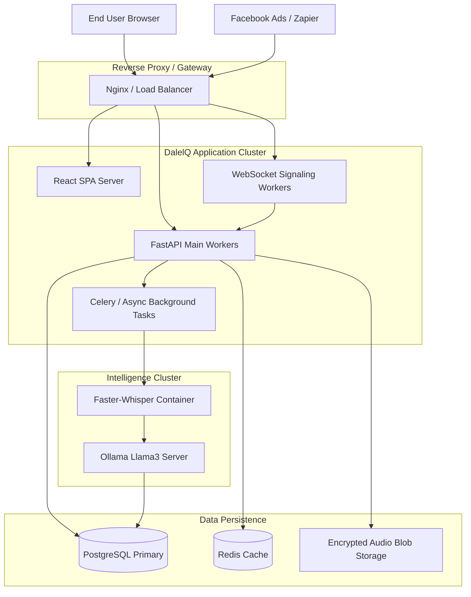
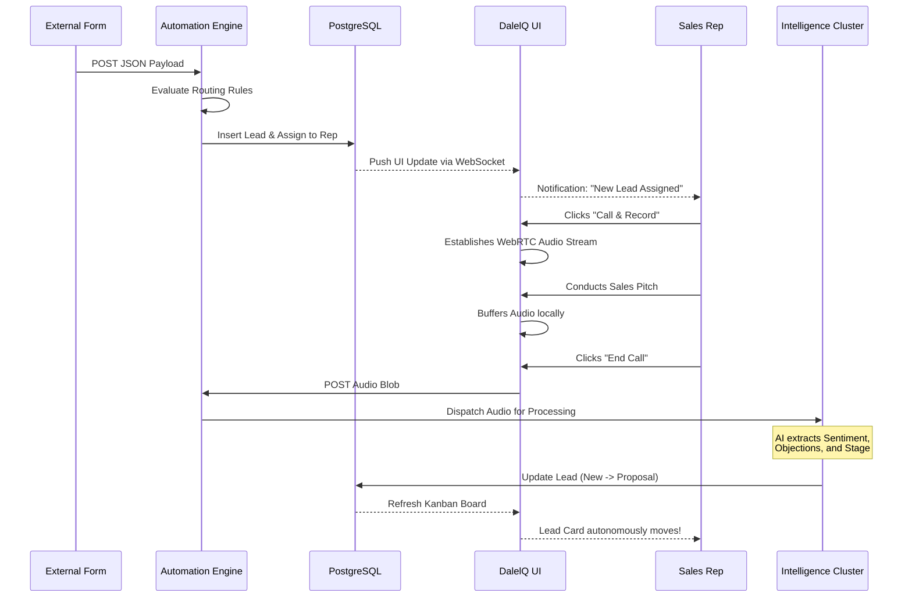

# DalelQ - The Master Configuration and Operational Manual

Welcome to the definitive operational manual for DalelQ. This document is intended for systems administrators, sales operations managers, and end-user representatives. It comprehensively details the internal mechanics, configurations, and operational workflows of the DalelQ ecosystem.

---

## Chapter 1: Architectural Philosophy

DalelQ fundamentally reimagines the Customer Relationship Management (CRM) experience. Legacy platforms require humans to dictate reality to the database. DalelQ listens to reality and dictates it to the database.

### 1.1 The Concept of "Active Intelligence"
When a sales representative interacts with a prospect, a vast amount of metadata is generated: tone of voice, hesitation, specific objections, mentioned competitors, and budget constraints. In legacy systems, this data is lost the moment the call ends unless the representative painstakingly types it into a text box. 

DalelQ employs **Active Intelligence**. By deeply integrating the communication layer (WebRTC) with the processing layer (LLMs and Neural Networks), DalelQ acts as an invisible sales engineer. It captures the raw audio stream, converts it to text, parses the semantic meaning of that text, and executes database mutations autonomously.

### 1.2 Multi-Tiered Tenancy
DalelQ is designed for B2B SaaS distribution. 
- **The System Administrator (Super Admin):** Has absolute authority over the infrastructure. They view the global tenant list, manage system-wide health, and provision new organizational workspaces. They are mathematically excluded from all sales analytics to prevent metric skewing.
- **The Organization Manager:** Has authority over a specific company workspace. They create routing rules, monitor Team Pulse analytics, and manage Sales Representatives.
- **The Sales Representative:** The frontline user. Their interface is streamlined entirely around execution: making calls, viewing assigned leads, and closing deals.

---

## Chapter 2: The Core Modules

This section details the functional operation of every visible and invisible module within DalelQ.

### 2.1 The Dynamic Sales Pipeline (Kanban Execution Engine)

The pipeline is the heartbeat of DalelQ. It is an interactive, fluid representation of current revenue opportunities.

**Workflow Operations:**
1. **Lead Ingestion:** Leads enter the pipeline either manually via the user interface, via CSV bulk import, or autonomously via the Automation Engine Webhooks.
2. **Stage Progression:** The pipeline is divided into distinct stages: *New*, *Discovery*, *Proposal*, *Negotiation*, *Won*, and *Lost*.
3. **Autonomous Movement:** While users can manually drag-and-drop lead cards, the true power of DalelQ is its auto-progression. If an AI call analysis determines that a "New" lead successfully established BANT criteria (Budget, Authority, Need, Timeline), the system will autonomously advance the card to "Proposal" without human input.
4. **Predictive Highlighting:** Leads are assigned dynamic "AI Scores". Cards that cross a specific algorithmic threshold (e.g., >80) are visually highlighted as "Hot," directing the sales representative's immediate attention.

### 2.2 The Self-Hosted Communications Array (Voice Intelligence)

DalelQ does not integrate with Aircall, RingCentral, or Twilio for core routing. It *is* the telephony provider.

**Technical Execution:**
1. **Hardware Interfacing:** The platform requests direct access to the user's local microphone via the browser's `navigator.mediaDevices` API.
2. **WebRTC Signaling:** A real-time peer-to-peer connection is negotiated over WebSockets using Session Description Protocol (SDP) and ICE candidates.
3. **Stream Buffering:** As the conversation occurs, the audio is routed through a localized AudioContext node, ensuring that the raw byte stream is captured in high fidelity (`audio/webm` or `audio/mp4`).
4. **Asynchronous Hand-off:** Upon call termination, the audio blob is securely POSTed to the backend. The UI immediately returns to an idle state, allowing the representative to make their next call immediately while the AI engine works in the background.

### 2.3 The Artificial Intelligence Processing Pipeline

Once the audio reaches the server, the AI engine takes over.

**Phase 1: Neural Transcription**
The audio file is ingested by `faster-whisper`, a highly optimized CTranslate2 implementation of OpenAI's Whisper model. This runs entirely on the local server CPU/GPU. It converts the audio waves into a highly accurate text transcript, complete with punctuation and speaker diarization.

**Phase 2: Semantic LLM Parsing**
The raw text is then injected into a heavily engineered prompt and sent to an LLM (Large Language Model). The LLM acts as an extraction engine, returning a strictly formatted JSON object containing:
- **Sentiment Classification:** Is the prospect hostile, neutral, or receptive?
- **Objection Detection:** Did the prospect mention "Too expensive" or "Locked in a contract"?
- **Competitor Tracking:** Were other products explicitly named?
- **Action Items:** What did the sales rep promise to do next?
- **Suggested Stage:** Based on the conversation, where should this lead exist in the pipeline?

**Phase 3: Database Mutation**
The backend parses this JSON, saves it to the Lead's historical activity timeline, recalculates the Lead's global AI Score, and executes the pipeline stage movement.

### 2.4 The Automation and Routing Engine

Leads generated by marketing must reach the correct sales representative instantly. 

**Webhook Catchers:**
Managers can generate unique API endpoints for different marketing channels (e.g., a URL for Facebook Ads, a URL for a website "Contact Us" form).

**The Rules Engine:**
Once a webhook is triggered, the JSON payload is evaluated against user-defined "If/Then" logic.
- *Condition:* IF `source` EQUALS `Facebook` AND `intent` EQUALS `High`.
- *Execution:* THEN execute `assign_to_user` targeting `Representative A`.

If a payload fails or is malformed, it is caught and displayed in the Webhook Logs view for immediate debugging, preventing silent lead loss.

### 2.5 The Pulse Analytics Dashboards

Data is only useful if it can be interpreted instantly. DalelQ splits analytics into two distinct views to prevent information overload.

**Team Pulse (Manager View):**
Provides macro-level organizational health metrics.
- *Win Rate Velocity:* Calculates the percentage of leads successfully moved to the "Won" column within the current 30-day trailing period.
- *Weighted Pipeline Value:* Multiplies the raw revenue potential of open deals by the historical close rate of their current pipeline stage.
- *Global Sentiment Distribution:* A macro view of all conversations happening across the company to detect market shifts.

**My Pulse (Representative View):**
Provides micro-level execution metrics.
- Focuses entirely on the individual's daily tasks, upcoming meetings, and personal conversion rates.

---

## Chapter 3: Implementation Diagrams

Visualizing the internal mechanics of DalelQ ensures that operations teams understand the data flow.

### 3.1 The Infrastructure Topology

### 3.2 The Lead Lifecycle Sequence

---

## Chapter 4: Industry Positioning & Competitive Matrix

To truly understand DalelQ's value proposition, it must be evaluated against the current titans of the software industry.

### 4.1 The Legacy Giants (Salesforce & HubSpot)
**Salesforce** and **HubSpot** are horizontal platforms. They are designed to be customized by armies of consultants to fit any business on earth. 
- *The Flaw:* They are passive. They require immense manual data entry from sales representatives to function correctly. If a rep forgets to log a call, the CRM thinks the call never happened.
- *The DalelQ Advantage:* DalelQ is vertical and opinionated. It believes the CRM should work for the rep, not the other way around. By making the CRM the actual telephone, data capture is 100% guaranteed. 

### 4.2 The Intelligence Add-ons (Gong.io & Chorus.ai)
**Gong** and **Chorus** pioneered conversational intelligence. They join Zoom calls or ingest audio, analyze it, and provide coaching metrics.
- *The Flaw:* They are separate from the CRM. They act as an analytical overlay. They can tell you *why* a deal is stalling, but they cannot physically move the deal in Salesforce for you. 
- *The DalelQ Advantage:* DalelQ natively merges Gong's intelligence with Salesforce's execution. The intelligence engine isn't just an observer; it has write-access to the database. It analyzes the call and executes the pipeline update autonomously.

### 4.3 Feature Comparison Matrix

| Capability | DalelQ | Salesforce | HubSpot | Gong.io |
| :--- | :--- | :--- | :--- | :--- |
| **Primary Architecture** | Unified AI CRM | Relational Database | Inbound Marketing | Analytical Overlay |
| **Native WebRTC Dialer** | **Built-in, standard** | Requires 3rd Party (Twilio) | Built-in (Limited) | Requires 3rd Party |
| **Local Audio Transcription** | **Yes (Faster-Whisper)** | No (Cloud only) | No (Cloud only) | No (Cloud only) |
| **Data Entry Requirement** | **Zero (Autonomous)** | Extremely High | Moderate | Read-Only |
| **Auto-Pipeline Progression** | **Yes, via LLM Intent** | Manual or Rule-based | Rule-based only | N/A |
| **Multi-Tenant Isolation** | **Yes, Row-Level Security** | Yes | Yes | Yes |
| **BANT Extraction** | **Native via Prompting** | Custom Config Required | Custom Config Required | Native |

---

## Chapter 5: Operational Best Practices

### 5.1 Maximizing AI Accuracy
The LLM relies heavily on transcription accuracy. 
- **Audio Quality:** Ensure sales representatives are using high-quality USB headsets. WebRTC relies on clear input. Heavy background noise will degrade the `faster-whisper` output, which in turn confuses the LLM.
- **Model Selection:** The default configuration uses `base.en` for Whisper to prioritize speed. If your organization has the necessary GPU compute, upgrading to `medium.en` or `large-v3` will significantly improve the detection of complex technical objections.

### 5.2 Designing Bulletproof Automation Rules
The Automation Engine executes synchronously.
- **Order of Operations:** Ensure your most specific routing rules execute first. If a broad rule (e.g., *Catch All Website Leads*) triggers before a specific rule (e.g., *Catch Website Leads from Enterprise Pricing Page*), the lead will be routed incorrectly. 
- **Webhook Hygiene:** Regularly monitor the Webhook Logs interface. Marketing teams frequently change form fields without notifying sales operations. The logs will immediately flag payloads that are failing validation.

### 5.3 System Administration and Maintenance
The Super Admin is responsible for the long-term health of the DalelQ instance.
- **Storage Management:** Audio files consume exponential storage. Implement a chron job to archive or delete `.webm` blobs older than 90 days if legal compliance allows. The text transcripts and LLM JSON insights are permanently stored in PostgreSQL and consume negligible space.
- **Tenant Management:** When provisioning a new company workspace, ensure the initial Company Admin is configured correctly. Do not assign them the `is_super_admin` flag, or they will bypass their organizational sandbox.

---
*End of Manual.*
